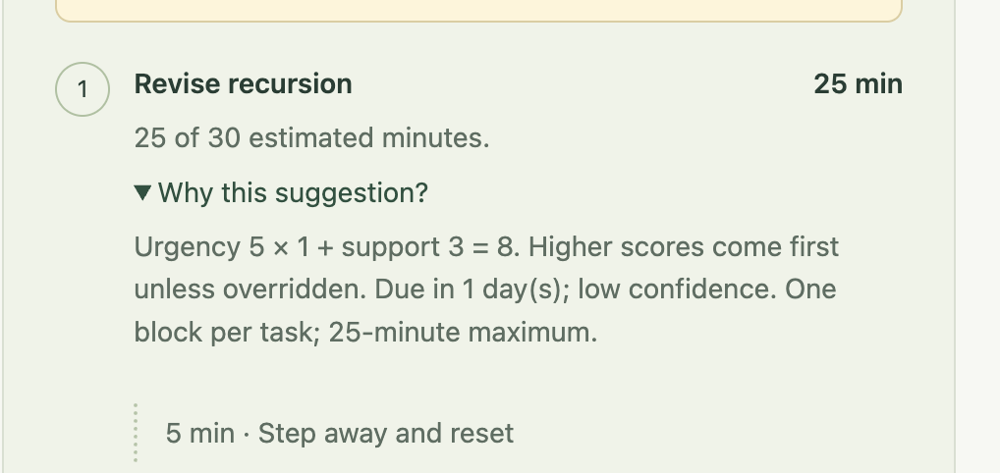
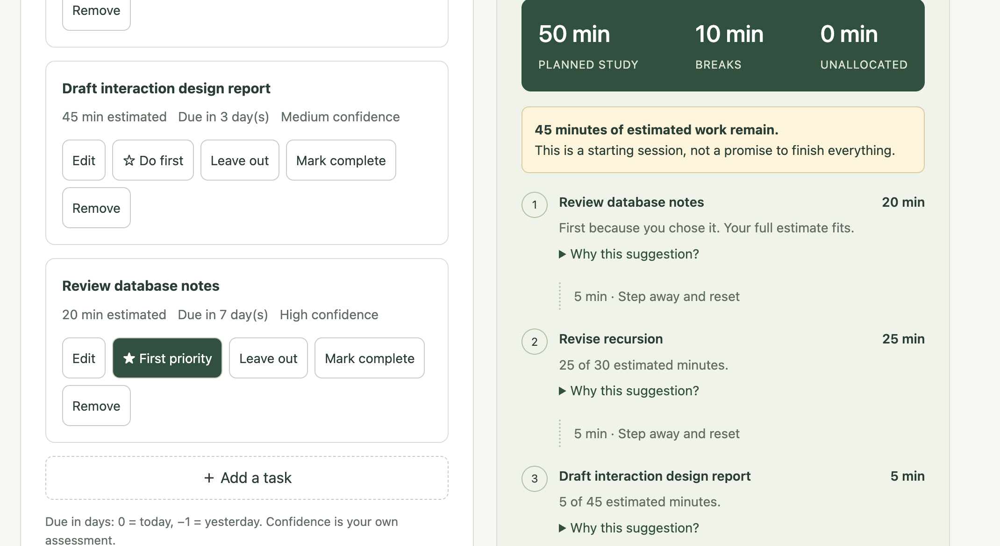
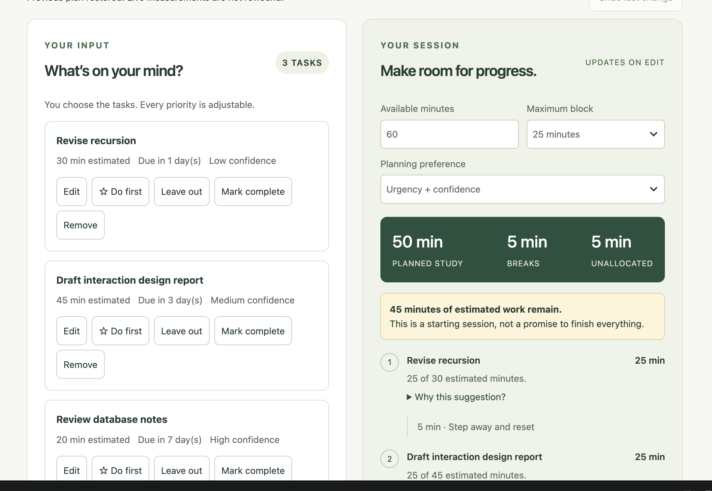
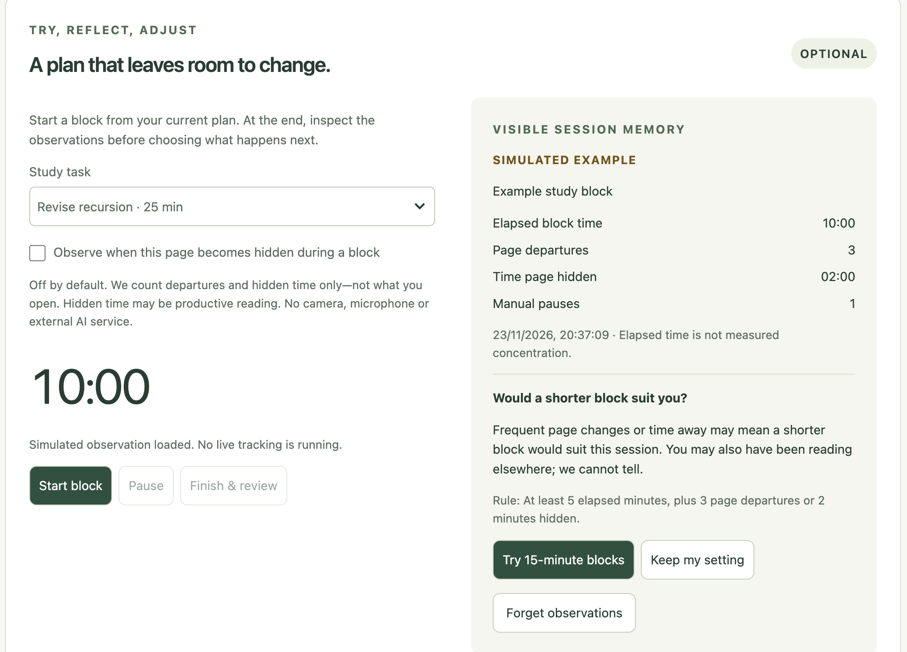
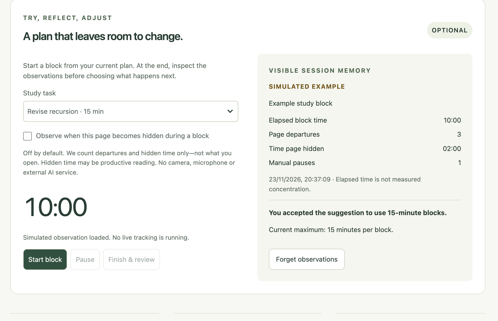
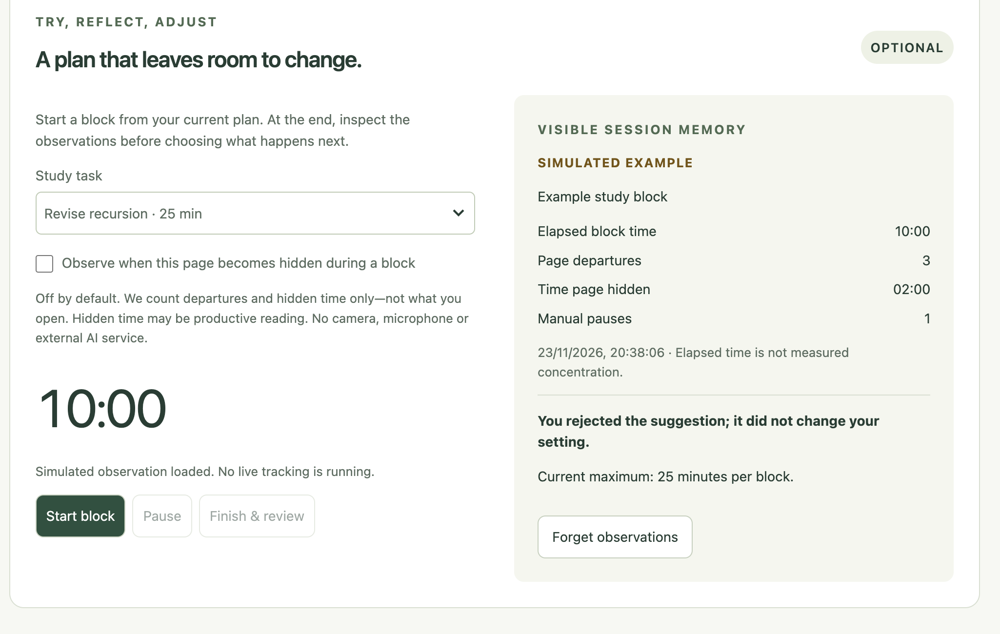
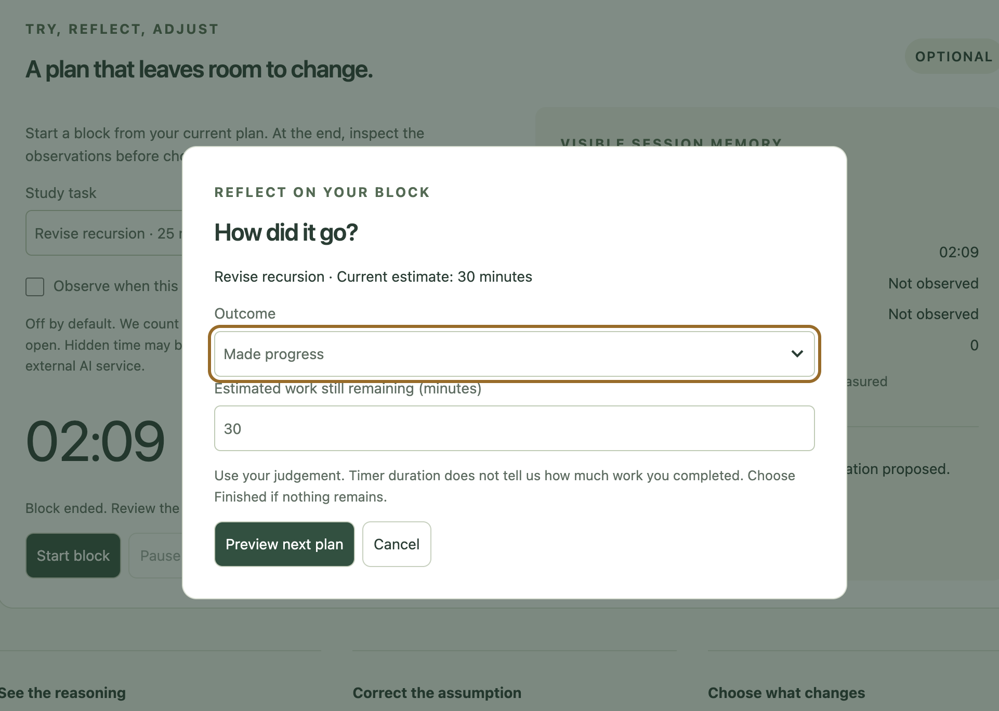
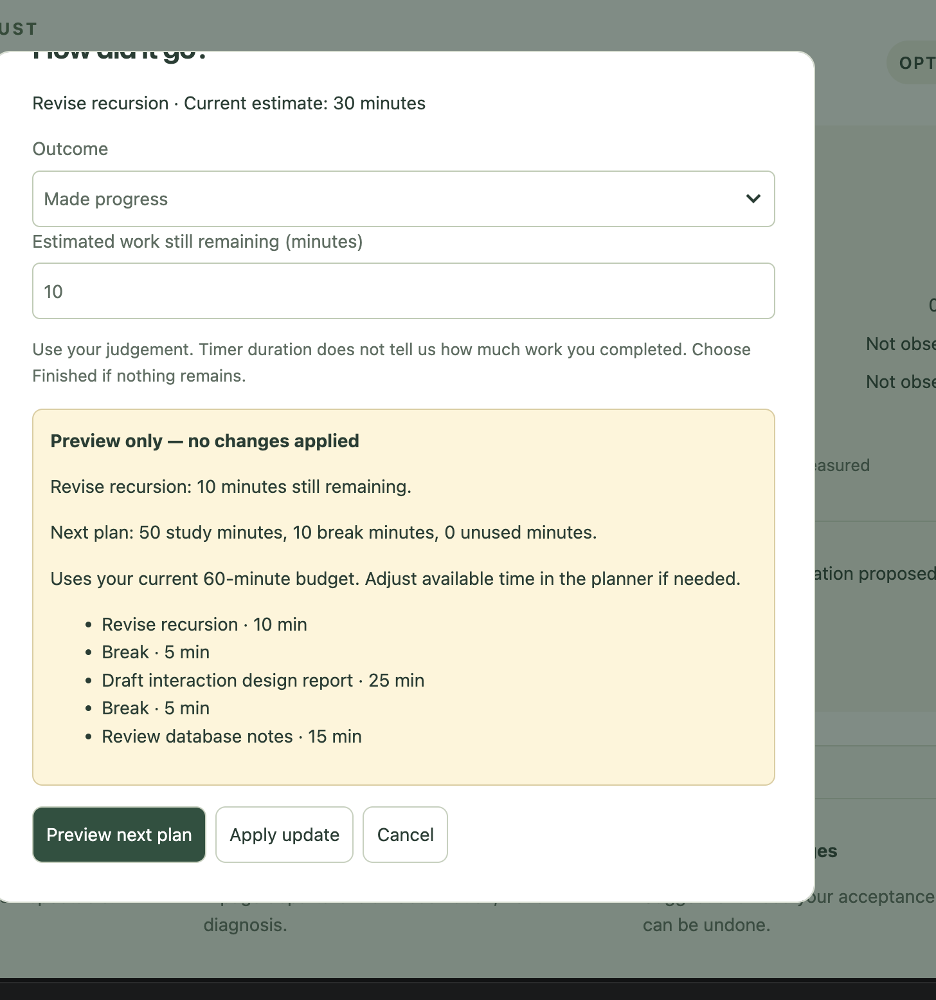
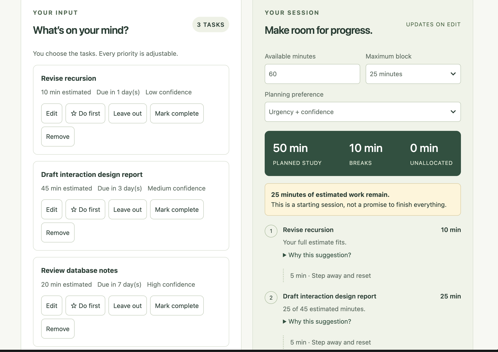
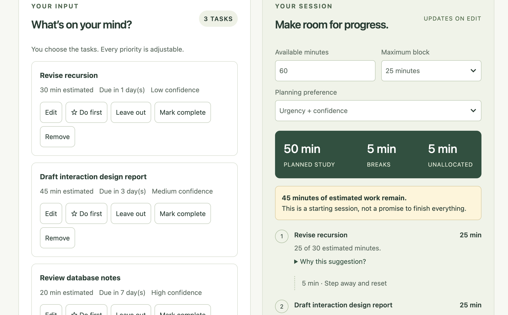

# Studyloom interaction walkthrough

These three examples document a developer walkthrough captured on
23 November 2026. They demonstrate interface behaviour, not an
independent user study or evidence of improved learning.

## 1. Inspect, override and undo a recommendation

The student inspects why “Revise recursion” appears first.
Studyloom exposes the urgency and confidence contributions to its
score, along with the block-length limit.

The student chooses “Do first” for “Review database notes”.
This explicit preference takes precedence over the calculated ranking.
The plan identifies that the task is first because the student chose it.

The student undoes the change. The original ordering and allocation
return: 50 study minutes, 5 break minutes and 5 unallocated minutes.

This interaction makes the recommendation inspectable, lets the student
correct it and provides a reversible action.

## 2. Inspect and control an adaptation suggestion

A clearly labelled simulated example supplies 10 elapsed minutes,
3 page departures, 2 hidden minutes and 1 manual pause. No live
tracking is running in this example.

Studyloom proposes shorter blocks and displays its triggering rule.
It acknowledges that time away could represent productive reading;
these observations do not establish distraction or concentration.

In the acceptance branch, the student chooses “Try 15-minute blocks”.
Studyloom confirms the decision and updates the maximum block length
and task selection.

In a separate run of the simulated example, the student chooses
“Keep my setting”. Studyloom confirms rejection and retains the
25-minute maximum.

Acceptance and rejection are alternative outcomes, not consecutive
decisions on one suggestion. The system proposes a change; the
student controls whether it takes effect.

## 3. Review progress, preview a change and undo it

After ending a real timer block, the student opens the progress review.
Page-visibility observation is off. The form asks the student to judge
the work remaining rather than deriving completion from elapsed time.

The student enters 10 remaining minutes and previews the next plan.
The preview explicitly states that no changes have been applied.
It uses the current 60-minute budget and offers Apply update or Cancel.

After applying the update, the task card shows a 10-minute estimate.
The revised plan contains 50 study minutes and 10 break minutes,
with 25 minutes of estimated work left outside the plan.

The student undoes the update. The task estimate returns to 30 minutes,
while its scheduled block returns to 25 minutes because of the
maximum-block setting.

The changed estimate is a demonstration input supplied by the student.
It is not a measurement of work completed or learning gained.
Preview, explicit application and undo keep the student in control.
