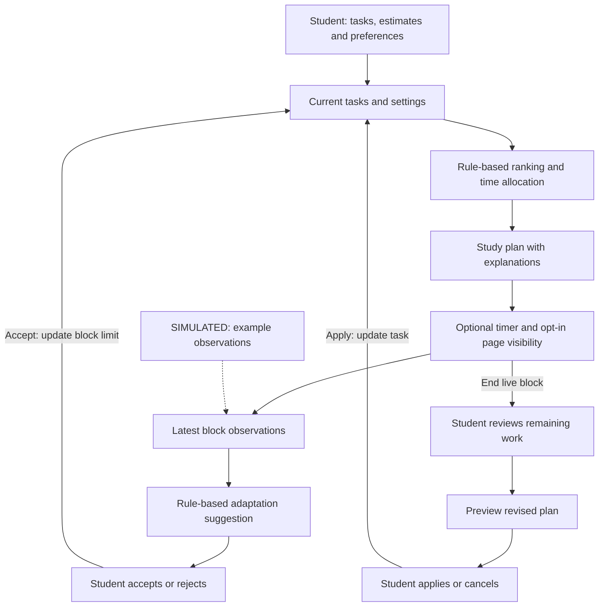
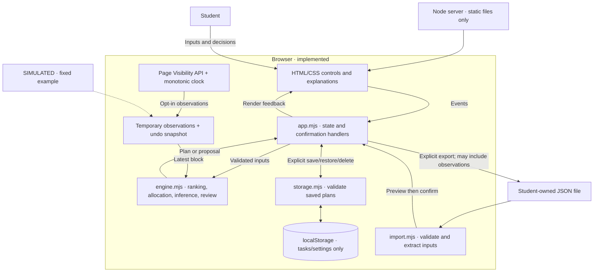

# Studyloom system diagram

Solid connections show implemented flows. The dashed connection supplies
explicitly simulated observations. No trained model or external AI API is used.

## Boundaries

- Inference uses selected rules and thresholds, not a trained model.
- Page visibility does not reveal which other pages or applications are used.
- Hidden time is not proof of distraction.
- Observations and timer activity remain in tab memory.
- Optional browser storage contains only tasks and planning settings.
- Export can include observations; import ignores them.
- Preview does not change the plan until the student confirms.
- Undo restores plan state, not elapsed time or forgotten observations.
- The local Node.js server serves files; planning runs in the browser.
- No planned-only components are included in this diagram.

### Implementation and control boundaries

- All components shown are implemented. The dashed connection supplies
  explicitly labelled simulated observations for demonstration.
- Ranking and adaptation use transparent rules, not a trained model
  or external AI service.
- Page-visibility observation is optional and off by default.
  Hidden time does not establish distraction or concentration.
- Rejecting an adaptation or cancelling a review leaves the current
  plan settings or task estimates unchanged.
- Students can override task priority and undo the latest plan change.
  Undo does not reverse elapsed time or recover forgotten observations.
- Observations remain temporary and can be forgotten.
- Explicit browser saving stores tasks and settings. Restore and delete
  are student-controlled actions.
- JSON export supports downloading a snapshot. Import validates tasks
  and settings, previews the replacement and requires confirmation.
  Imported observations do not become live evidence.
- The local Node server serves website files; the application logic runs
  in the browser.

## Component architecture

This companion view shows implementation boundaries; the flow above explains the student-controlled loop. All solid boxes and connections below are implemented. Only the labelled demo input supplies simulated observations. No planned-only component is claimed.

The static server does not receive task data. Import excludes exported observations, decisions and calculated plans. Saving excludes timer observations and inferred decisions. The intelligence is the deterministic ranking and uncertain adaptation rule; confirmation handlers control whether proposals change state.
