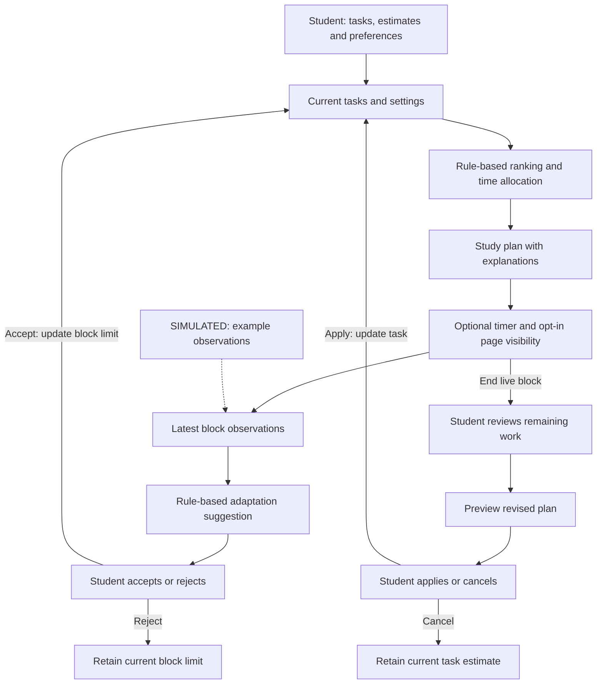
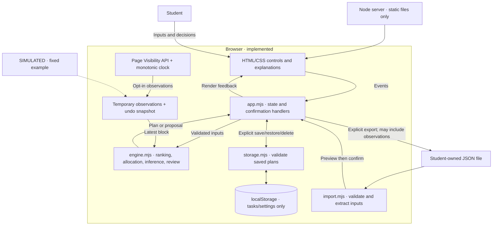

# Studyloom system diagram

Implementation: `e8b1227a9c239258207392e7081106e52986dcad`. The redesigned dashboard retains the student-controlled interaction architecture and supports manually specified maximum block durations.

Solid connections show implemented flows. The dashed connection supplies
explicitly simulated observations. No trained model or external AI API is used.

## Implementation and control boundaries

- Ranking and adaptation use deterministic rules and thresholds, not a trained model or external AI service.
- Students can specify a maximum block length of 5–240 whole minutes. Each eligible task receives at most one block, constrained by its estimate, the maximum and the remaining budget.
- Adaptation proposes a 15-minute maximum only when the current maximum exceeds 15 minutes.
- Page-visibility observation is optional and off by default. It cannot identify which other websites or applications are being used.
- Hidden time does not establish distraction, concentration or learning.
- Simulated observations are explicitly labelled and are separate from live task progress.
- Rejecting an adaptation retains the current block limit. Cancelling a progress review retains the current task estimate.
- Students can override task priority and undo the latest plan change. Undo restores plan state, not elapsed time or forgotten observations.
- Timer activity and observations remain temporary and can be forgotten.
- Explicit browser saving stores tasks and planning settings. Restoration and deletion are student-controlled.
- JSON export can include observations. Import validates tasks and settings, previews replacement and requires confirmation. Imported observations do not become live evidence.
- The local Node server serves static files; planning and inference run in the browser.
- All illustrated components represent implemented functionality rather than proposed future features.

## Component architecture

This companion view shows implementation boundaries; the flow above explains the student-controlled loop. All solid boxes and connections below are implemented. Only the labelled demo input supplies simulated observations. No planned-only component is claimed.

The static server does not receive task data. Import excludes exported observations, decisions and calculated plans. Saving excludes timer observations and inferred decisions. The intelligence is the deterministic ranking and uncertain adaptation rule; confirmation handlers control whether proposals change state.
