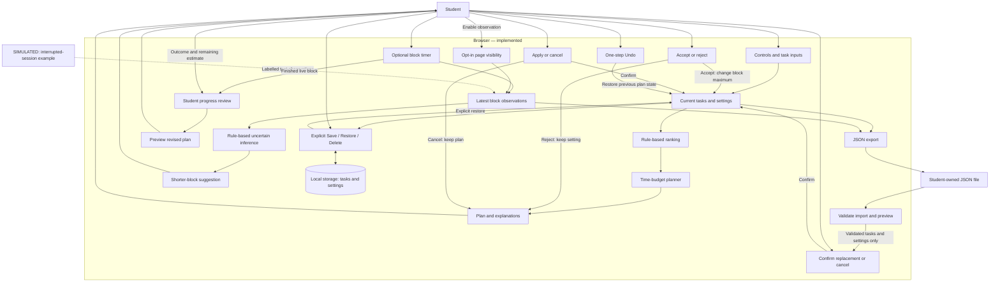

# Studyloom system diagram

Solid connections show implemented flows. The dashed connection supplies
explicitly simulated observations. No trained model or external AI API is used.

## Boundaries

- Inference uses selected rules and thresholds, not a trained model.
- Page visibility does not reveal which other pages or applications are used.
- Hidden time is not proof of distraction.
- Observations and timer activity remain in tab memory.
- Optional browser storage contains only tasks and planning settings.
- Export can include observations; import ignores them.
- Preview does not change the plan until the student confirms.
- Undo restores plan state, not elapsed time or forgotten observations.
- The local Node.js server serves files; planning runs in the browser.
- No planned-only components are included in this diagram.
