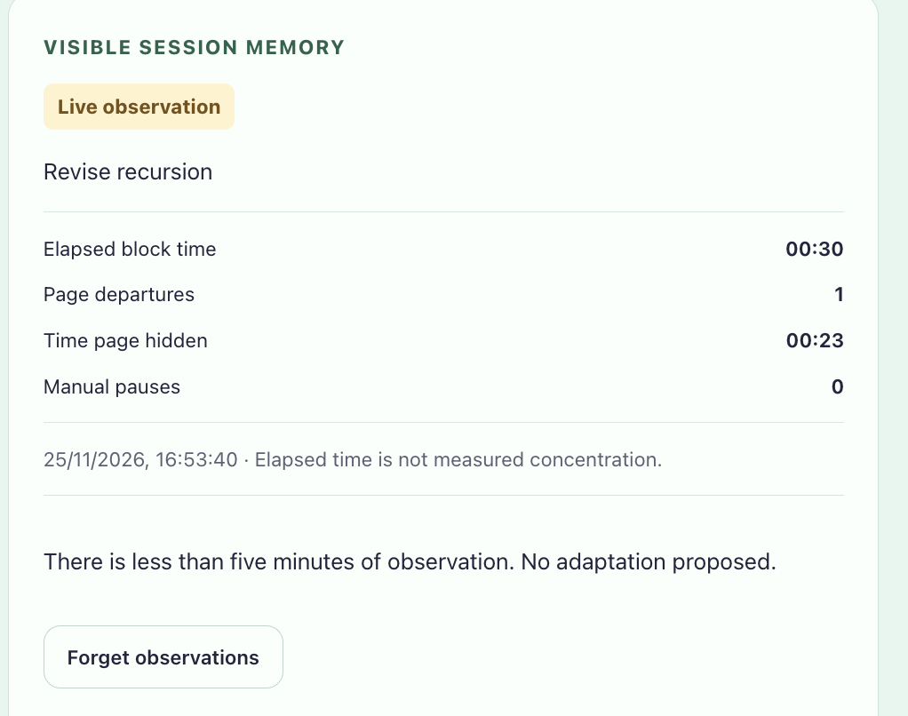
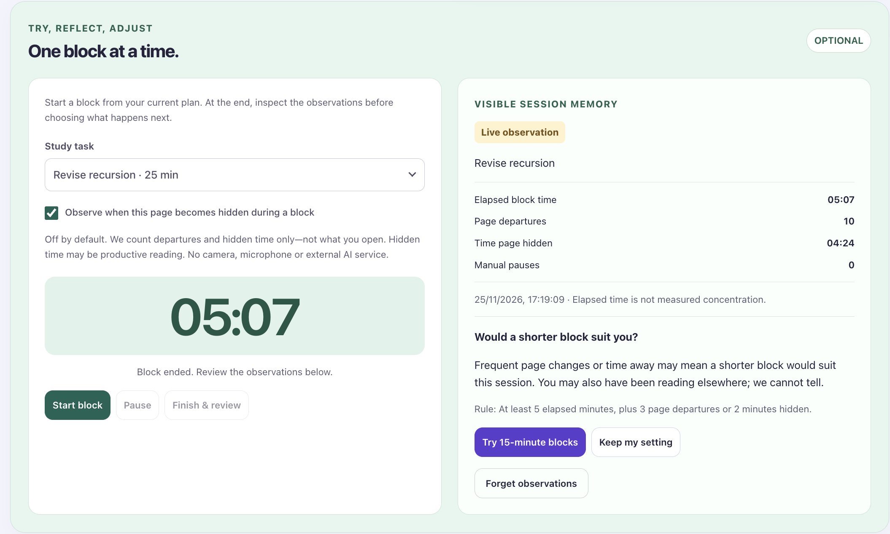

# Studyloom verification evidence

Website implementation: [`e8b1227a9c239258207392e7081106e52986dcad`](https://github.com/sxk1420/studyloom/commit/e8b1227a9c239258207392e7081106e52986dcad).

## Evidence summary

- **Automated:** 63 tests passed, comprising 17 engine, 38 interface, 5 storage and 3 import-validation tests. The latest run against the redesigned HTML passed on 25 November 2026 before the same website files were committed.
- **Manual:** On 25 November 2026, the developer reported that all 18 supplied browser checks worked. The matrix below records that report; the assistant did not independently observe those interactions.
- **Supplementary verification:** Two additional developer-led live-observation demonstrations provide screenshot evidence of insufficient-evidence abstention and threshold-based adaptation.
- **Browser:** The original 18 checks used VS Code's embedded browser, as confirmed by the developer. Browser versions were not recorded. Individual timings, logs and screenshots were not supplied for every original check, limiting reproducibility.
- **Screenshots:** Twelve evidence captures document the redesigned interface, including ten interaction walkthrough screenshots and two supplementary live-observation demonstrations.
- **Limitations:** No independent participant study, screen-reader audit or systematic cross-browser evaluation has been conducted. These checks do not establish improved learning, concentration or appropriate reliance.

## Developer-reported manual results

Every result below is **reported pass**, based on the developer's aggregate confirmation after receiving this numbered checklist. It is not a separately recorded observation for each case.

| #   | Check                  | Expected behaviour                                                                                                            | Result        |
| --- | ---------------------- | ----------------------------------------------------------------------------------------------------------------------------- | ------------- |
| 1   | Default plan           | Balanced hour: 50 study, 5 break and 5 unused minutes; recursion first.                                                       | Reported pass |
| 2   | Task controls          | Add/edit, priority, exclusion, completion, reopening, removal and Undo update the plan appropriately.                         | Reported pass |
| 3   | Invalid task input     | Empty name, zero duration and fractional duration cannot be saved.                                                            | Reported pass |
| 4   | Manual maximum         | 37 is accepted; recursion receives its 30-minute estimate; 4, 241 and 12.5 restore 37.                                        | Reported pass |
| 5   | Limited time           | Twenty-minute example schedules one 20-minute block and exposes 75 remaining minutes.                                         | Reported pass |
| 6   | Priority and Undo      | Database notes moves first; Undo restores recursion first.                                                                    | Reported pass |
| 7   | Timer controls         | Elapsed time stops during pause and continues on resume.                                                                      | Reported pass |
| 8   | Undo during a block    | Running/paused blocks retain the original task and duration; finishing offers progress review.                                | Reported pass |
| 9   | Progress review        | Preview/cancel preserve the estimate; Apply changes it to 10; Undo restores the original.                                     | Reported pass |
| 10  | Simulated adaptation   | Explicit simulation: 42→15 only on acceptance; Undo restores 42; rejection preserves the setting; 10 is not increased.        | Reported pass |
| 11  | Saving/restoration     | A saved task and custom maximum survive refresh and explicit Restore; later changes do not autosave.                          | Reported pass |
| 12  | Export/import          | Cancel preserves inputs; confirmation imports them; Undo restores the pre-import state.                                       | Reported pass |
| 13  | Forget observations    | Evidence/decisions disappear and Undo is disabled; current tasks and explicitly saved copy remain.                            | Reported pass |
| 14  | Observation off        | Switching tabs does not collect departures or hidden time; the display says Not observed.                                     | Reported pass |
| 15  | Observation on         | Three departures over at least five unpaused minutes produce a tentative suggestion after finishing, with a maximum above 15. | Reported pass |
| 16  | Automatic finish       | A five-minute block ends with review available; the task is not automatically complete.                                       | Reported pass |
| 17  | Keyboard/dialogs       | Tab, Shift+Tab, Enter and Escape provide visible focus, modal containment and useful focus return.                            | Reported pass |
| 18  | Narrow layout and zoom | At 375px width and separately at 200% zoom, controls/dialogs remain reachable without clipping or horizontal overflow.        | Reported pass |

These results describe the tested developer setup only. They are not an accessibility-conformance claim. The keyboard check did not include a screen reader.

## Supplementary live-observation verification

**Date:** 25 November 2026

Two additional developer-led browser walkthroughs examined selective adaptation using live page-visibility observations rather than simulated inputs.

These demonstrations supplement the original 18 reported manual checks with direct screenshot evidence of live sensing, insufficient-evidence abstention and threshold-based adaptation.

| Recorded measurement |  Insufficient evidence |     Sufficient evidence |
| -------------------- | ---------------------: | ----------------------: |
| Observation type     |       Live observation |        Live observation |
| Study task           |       Revise recursion |        Revise recursion |
| Elapsed block time   |             30 seconds |             307 seconds |
| Page departures      |                      1 |                      10 |
| Hidden time          |             23 seconds |             264 seconds |
| Manual pauses        |                      0 |                       0 |
| Expected behaviour   |          No adaptation |    Tentative adaptation |
| Observed behaviour   | No adaptation proposed | Shorter blocks proposed |
| Result               |                   Pass |                    Pass |

### Demonstration 19 — Insufficient-evidence abstention

**Objective:** Verify that Studyloom does not propose an adaptation when insufficient observation time has elapsed.

**Recorded observations:**

- Elapsed block time: 00:30
- Page departures: 1
- Time page hidden: 00:23
- Manual pauses: 0
- Observation type: Live observation
- Recorded timestamp: 25 November 2026, 16:53:40

**Expected behaviour:** The system should abstain from proposing an adaptation because the minimum observation requirement of five elapsed minutes has not been satisfied.

**Observed behaviour:** Studyloom displayed:

> There is less than five minutes of observation. No adaptation proposed.

The recorded observations remained inspectable, and the Forget observations control was available.

**Result:** Pass.



This demonstrates bounded inference and transparent abstention rather than intervention based on isolated visibility events. The system communicates why it has not made a recommendation.

The screenshot establishes the absence of an adaptation proposal. It does not independently display the planner's maximum-duration setting.

### Demonstration 20 — Live observation and adaptation

**Objective:** Verify that actual page-visibility observations can trigger an explainable adaptation suggestion when the required thresholds are satisfied.

**Recorded observations:**

- Elapsed block time: 05:07
- Page departures: 10
- Time page hidden: 04:24
- Manual pauses: 0
- Observation type: Live observation
- Recorded timestamp: 25 November 2026, 17:19:09

**Expected behaviour:** With the current maximum above 15 minutes, sufficient elapsed time and either the departure threshold or hidden-time threshold should trigger a tentative suggestion to use shorter blocks.

**Observed behaviour:** Studyloom displayed a suggestion asking whether a shorter block would suit the student. The interface explicitly acknowledged that hidden time could represent productive reading rather than distraction.

The screenshot demonstrates:

- Explicit opt-in observation.
- Live elapsed-time measurement.
- Recorded page departures and hidden time.
- Transparent presentation of the adaptation threshold.
- Acknowledgement of uncertainty.
- A suggestion presented after the study block ended.
- Acceptance and rejection controls.
- A control for forgetting observations.

The proposed adaptation was presented through two available decisions:

- Try 15-minute blocks.
- Keep my setting.

**Result:** Pass for live sensing and suggestion generation. Acceptance and rejection outcomes are demonstrated separately in the existing simulated walkthroughs.



The suggestion is not evidence that shorter blocks would objectively improve the student's concentration. It demonstrates that the implemented inference rule produces the expected interaction when its conditions are satisfied.

### Adaptation decision logic

The implemented adaptation rule requires:

1. At least five elapsed, unpaused minutes.
2. At least three page departures OR at least two minutes of hidden time.
3. A current maximum block duration greater than 15 minutes.

If these conditions are not satisfied, no shorter-block adaptation is proposed.

When the conditions are satisfied, Studyloom presents a tentative suggestion. The current setting is not changed automatically. Students may accept the proposed 15-minute maximum or retain their existing setting.

### Interpretation and limitations

Together, the supplementary walkthroughs demonstrate:

- Live sensing through browser page-visibility observations.
- Threshold-based interpretation.
- Abstention when evidence is insufficient.
- Explainable adaptation when evidence is sufficient.
- Explicit acknowledgement of uncertain inference.
- Student authority over consequential changes.

These demonstrations complement the automated threshold tests and simulated acceptance and rejection scenarios.

The observations were deliberately generated by the developer for functional verification. They do not establish natural study behaviour, accurate attention inference, improved decision-making or educational effectiveness.

## Reproduce the automated checks

From the repository root:

```sh
npm ci
npm test
```

Individual commands:

```sh
npm run test:engine
npm run test:interface
npm run test:storage
node --test tests/import.test.mjs
```

### Automated test breakdown

| Test suite                    | Tests passed |
| ----------------------------- | -----------: |
| Planning and inference engine |           17 |
| Interface interactions        |           38 |
| Storage                       |            5 |
| Import validation             |            3 |
| **Total**                     |       **63** |

The engine suite checks allocation, ranking, boundaries, timing and review.

Allocation invariants run for all 55,696 budget/maximum pairs from 5 through 240. These checks examine the consistency of time-budget accounting and block-duration constraints across the supported range.

Storage and import tests check field selection, corrupt or invalid data and preservation of original inputs.

The interface suite reads the actual HTML and imports a fresh application module for each test. It checks actual event handlers using controlled time, synthetic visibility events, programmatic focus and dialog/scroll shims.

It restores globals and closes each document, failing on unhandled interface errors.

A Live observation label in these automated tests denotes the live application path receiving synthetic events, not a person being observed.

### What the automated evidence establishes

The automated tests provide repeatable evidence concerning:

- Ranking and allocation behaviour.
- Budget and duration boundaries.
- Interaction state transitions.
- Adaptation eligibility.
- Priority overrides and Undo.
- Timer controls and progress review.
- Storage and import behaviour.
- Recovery from invalid input.
- Preservation of original state during preview and cancellation.

Automated passes do not independently verify rendered CSS, native modal behaviour, actual tab events, browser throttling or screen-reader usability.

The developer-reported manual results and supplementary live-observation screenshots constitute separate evidence sources.

## Development regressions

At the review-repair stage, six cases were added:

1. Running-block Undo.
2. Paused-block Undo.
3. Restored removal before automatic finish.
4. Replacement-task rejection.
5. Consistent deadline wording.
6. Import-preview and cancellation wording.

Five failed before repair; the replacement-task guard already passed.

All six passed after repair, bringing the historical total to 58 tests.

### Active-timer identity and Undo

Undo restores cloned state. During development, this could break the association between an active timer and its original task.

Matching reusable numeric identifiers alone would risk attaching the timer to a replacement task.

The correction maps the original timed task to its position in the saved snapshot and reconnects it on restoration.

Elapsed measurements are never rewound.

This distinction preserves both error recovery and the integrity of session observations: students can restore planning decisions without rewriting recorded elapsed time.

### Custom maximum-duration controls

Five further cases cover:

1. Manual maximum validation.
2. Plan and Undo behaviour.
3. Invalid-input recovery.
4. Adaptation for custom limits.
5. Saving, restoring and importing custom limits.

Supporting arbitrary whole-minute maximums required consistent behaviour across planning, validation, persistence and adaptation.

The adaptation mechanism must not increase an existing maximum when proposing shorter blocks.

Together with the expanded allocation invariant check, these additional cases brought the total to 63 tests.

Earlier totals of 35, 49, 52 and 58 describe historical development milestones, not the current suite.

## Design decision and verification traceability

The following table connects important interaction decisions to their supporting implementation evidence.

| Design decision                  | Rationale                                                                         | Supporting evidence                                                    |
| -------------------------------- | --------------------------------------------------------------------------------- | ---------------------------------------------------------------------- |
| Explainable ranking              | Enable students to inspect actual recommendation inputs.                          | Engine and interface tests; recommendation walkthrough.                |
| Explicit priority override       | Preserve student knowledge that may not be represented in ranking inputs.         | Manual checks 2 and 6; override screenshots.                           |
| Reversible changes               | Reduce the consequences of interaction errors.                                    | Undo regression tests; restoration screenshots.                        |
| Optional observation             | Limit unnecessary behavioural data collection.                                    | Manual checks 13–15; live-observation evidence.                        |
| Insufficient-evidence abstention | Avoid suggesting adaptation based on inadequate observations.                     | Threshold tests; demonstration 19.                                     |
| Student-confirmed adaptation     | Prevent uncertain inference from automatically changing settings.                 | Manual check 10; simulated acceptance and rejection; demonstration 20. |
| Self-reported progress           | Avoid equating elapsed time with completed work.                                  | Manual checks 9 and 16; progress-review walkthrough.                   |
| Preview before applying          | Allow inspection of proposed consequences without changing the original estimate. | Interface tests; preview and cancellation evidence.                    |
| Explicit persistence             | Give students control over which planning inputs remain saved.                    | Storage tests; manual check 11.                                        |
| Validated import                 | Prevent invalid replacement inputs from silently changing the plan.               | Import-validation tests; manual check 12.                              |

This traceability connects design intent, implemented behaviour and verification without treating software correctness as evidence of educational effectiveness.

## Evidence interpretation

Different evidence sources answer different verification questions.

| Evidence source                  | What it supports                                                    | What it cannot establish                                  |
| -------------------------------- | ------------------------------------------------------------------- | --------------------------------------------------------- |
| Automated tests                  | Repeatable rule execution and state transitions.                    | Independent usability or educational outcomes.            |
| Allocation invariant checks      | Consistency across supported planning boundaries.                   | Whether a plan is educationally optimal.                  |
| Developer-reported manual checks | Reported interaction behaviour in the tested browser.               | Independent replication or accessibility conformance.     |
| Illustrated walkthroughs         | Observable interface states and demonstrated interaction sequences. | General user comprehension or satisfaction.               |
| Live-observation demonstrations  | Functional sensing, abstention and suggestion generation.           | Whether page visibility measures attention accurately.    |
| Simulated adaptation scenarios   | Acceptance, rejection and associated setting changes.               | Natural behavioural patterns or adaptation effectiveness. |

The project therefore distinguishes implementation verification from empirical evaluation of human outcomes.

## Automation environment and remaining limits

The assistant's 24 November browser attempt was blocked by a denied local listener and a Chrome launch failure.

On 25 November, permission enabled a preview server, which returned HTTP 200; Chrome still exited before loading a page.

Neither attempt establishes a visual browser pass.

The developer's subsequent reported browser checks and supplementary live-observation demonstrations are recorded separately.

Remaining unverified areas include:

- Screen-reader behaviour.
- Systematic cross-browser and device coverage.
- Sleep and background-throttling extremes.
- Colour-vision accessibility.
- Independent usability.
- Appropriate reliance in natural study contexts.
- Educational effectiveness.
- Whether shorter study blocks improve individual outcomes.

The redesigned interface is supported by refreshed walkthrough screenshots and two supplementary live-observation captures.

See the [screenshot checklist](screenshot-checklist.md) and [illustrated interaction walkthrough](interaction-walkthrough.md) for further evidence.

## Proposed independent evaluation

A future controlled evaluation could investigate whether inspectable explanations and user-controlled adaptation improve appropriate reliance beyond implementation correctness.

Participants could complete representative tasks involving:

1. Explaining why a recommendation was generated.
2. Identifying an unsuitable task priority.
3. Overriding the recommendation.
4. Recovering from an unintended change.
5. Interpreting ambiguous visibility observations.
6. Accepting a suitable adaptation.
7. Rejecting an unsuitable adaptation.
8. Previewing, applying and reversing a progress update.

Possible evaluation measures include:

- Recommendation comprehension.
- Task completion.
- Interaction errors.
- Recovery success.
- Decision time.
- Acceptance of suitable recommendations.
- Rejection of unsuitable recommendations.
- Perceived effort.

Explanation detail and recommendation suitability could be varied independently using controlled scenarios with known priorities.

This would distinguish appropriate reliance from indiscriminate acceptance or rejection.

Any independent participant evaluation would require compliance with applicable university ethics and coursework requirements.

This evaluation is proposed future work. It has not been conducted, and no participant findings are claimed.

## Test environment

- Verification date: 25 November 2026
- Operating system: macOS
- Device: MacBook Air
- Node.js: v24.9.0
- npm: 11.6.0
- Automated interface testing: jsdom 26.1.0
- Original manual-check browser: VS Code embedded browser
- Original browser version: unrecorded
- Supplementary live-observation browser and version: unrecorded
- Automated tests: 63 passed, 0 failed
- Skipped tests: 0
- Cancelled tests: 0
- Test execution time: approximately 2.40 seconds
- Allocation invariant combinations: 55,696
- Original developer-reported manual browser checks: 18 passed
- Supplementary screenshot-supported live demonstrations: 2 passed
- Total documented browser checks and demonstrations: 20
- Interaction evidence screenshots: 12

## Overall verification conclusion

Studyloom demonstrates implemented explainable planning, reversible interaction, bounded inference, live observation, selective adaptation and student-controlled progress review.

The automated suite, developer-reported manual checks and supplementary live-observation screenshots provide complementary evidence of functional behaviour.

The evidence supports the project's implemented interaction claims within the documented conditions. It does not establish improved learning, accurate concentration measurement, general accessibility conformance or empirically improved appropriate reliance.

These limitations remain explicit to distinguish demonstrated implementation from future research objectives.
